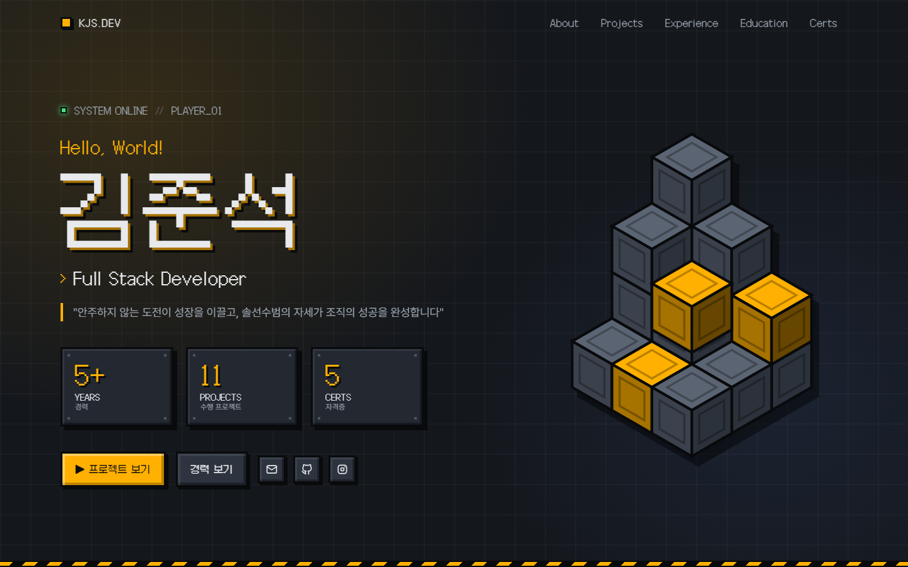

# 김준석 | 개발자 포트폴리오



제조 현장의 **MES**로 개발을 시작해 **ERP**, **TMS**, **AAS**까지 단계적으로 성장해 온 과정을 한 페이지로 정리한 웹 포트폴리오입니다.

🔗 **배포 주소:** https://kjs6646.github.io/portfolio-devtheme/

---

## 1. 목표

개발자로서의 기술 역량과 수행 프로젝트를 한 페이지로 정리한 웹 포트폴리오를 만들고, GitHub에 올려 **GitHub Pages**로 배포합니다.

## 2. 템플릿 선정 사유

[RyanFitzgerald/devportfolio](https://github.com/RyanFitzgerald/devportfolio) 템플릿을 기반으로 제작했습니다.

- 디자인이 깔끔하고 미니멀해서 내용을 전달하기 쉽습니다.
- 내용 대부분을 `src/config.ts` 파일 하나로 관리할 수 있습니다.
- AI 도구용 규칙 파일(`.cursor/rules`)이 함께 제공되어, AI와 협업해 효율적으로 만들 수 있습니다.

## 3. 사용 기술 및 환경

| 구분 | 내용 |
|---|---|
| 프레임워크 | Astro, Tailwind CSS v4, TypeScript |
| 도구 | VS Code, Git/GitHub, Node.js, Claude · Orca (AI 보조) |
| 배포 | GitHub Pages (GitHub Actions 자동 배포) |
| 폰트 | [Galmuri](https://github.com/quiple/galmuri) (픽셀 폰트), [Pretendard](https://github.com/orioncactus/pretendard) (본문) |
| 아이콘 | [Tabler Icons](https://tabler.io/icons) |

## 4. 페이지 구성

| 섹션 | 내용 |
|---|---|
| **메인** | 이름, 직무(타이핑 효과), 한 줄 소개, 경력·프로젝트·자격증 수치, 아이소메트릭 블록 일러스트 |
| **About** | 자기소개, 카테고리별 기술 스택(Language / Framework / Database / CI·CD / Tool) |
| **Projects** | 성장 스토리(QUEST LOG): MES → ERP → TMS → AAS → 에이전틱 바이브 코딩, 시스템별 설명과 담당 역할, 프로젝트 목록과 시스템별 필터 |
| **Experience** | 재직 회사와 담당 업무 |
| **Education** | 학교 및 학과 |
| **Certs** | 보유 자격증 |
| **Footer** | 연락처 및 소셜 링크 |

## 5. 원본 템플릿에서 바꾼 점

- **테마 전면 교체:** 기계적인 블록 질감의 다크 테마입니다.
  - 철판 패널, 리벳, 입체 테두리, 경고 줄무늬, 픽셀 폰트를 사용합니다.
  - 강조 색상은 앰버(`#ffb000`)입니다.
- **메인 화면 재구성:**
  - 직무를 타이핑 효과로 보여줍니다.
  - 경력·프로젝트·자격증 수치를 블록 패널로 표시합니다.
  - 아이소메트릭 블록 탑을 SVG로 직접 그렸습니다.
- **마우스 효과:** 마우스를 움직이거나 클릭하면 블록 부스러기가 튀어 떨어집니다. 터치 기기와 '동작 줄이기' 설정에서는 꺼집니다.
- **성장 스토리(QUEST LOG) 추가:**
  - 시스템별 단계, 난이도, 설명, 담당 역할을 보여줍니다.
  - 버튼을 누르면 해당 시스템의 프로젝트만 걸러서 볼 수 있습니다.
- **섹션 추가 및 정리:**
  - 자격증 섹션을 추가했습니다.
  - 기술 스택을 카테고리별로 나눴습니다.
  - 소셜 링크는 값이 있는 항목만 표시합니다(X 대신 Instagram).
- **배포 설정:** GitHub Pages용 `site`/`base` 경로와 GitHub Actions 워크플로를 추가했습니다.

## 6. 내용 수정 방법

화면에 보이는 내용은 대부분 **`src/config.ts`** 파일 하나만 고치면 바뀝니다.

| 항목 | 설명 |
|---|---|
| `name`, `title`, `tagline` | 이름, 직무, 메인 한 줄 소개 |
| `accentColor` | 강조 색상. 바꾸면 블록 일러스트와 마우스 효과까지 사이트 전체 색이 함께 바뀝니다. |
| `careerYears` | 메인에 표시되는 경력 연차 |
| `social` | 이메일, GitHub, Instagram, LinkedIn. 빈 값은 화면에서 숨겨집니다. |
| `aboutMe` | 자기소개 |
| `skills` | 카테고리별 기술 스택 (`{ category, items }`) |
| `journey` | 성장 스토리 도입부와 NEXT STAGE(현재 학습 중인 내용) |
| `systems` | 단계별 시스템(MES/ERP/TMS/AAS)의 스토리, 설명, 역할, 난이도 |
| `projects` | 프로젝트 목록. `system` 값으로 시스템별 필터가 동작합니다. |
| `experience` | 경력 |
| `education` | 학력 |
| `certifications` | 자격증 |

예시: 프로젝트 추가
```ts
projects: [
  {
    name: "프로젝트 이름",
    system: "AAS", // MES | ERP | TMS | AAS
    description: "프로젝트 설명 (인원 / 기간)",
    link: "", // 링크가 있으면 카드 클릭 시 이동
    skills: ["Vue", "Spring Boot"],
  },
],
```

## 7. 로컬 실행

```bash
npm install
npm run dev
```

브라우저에서 http://localhost:4321/portfolio-devtheme/ 으로 접속합니다.

배포용 빌드를 미리 확인하려면 다음을 실행합니다.
```bash
npm run build
npm run preview
```

## 8. 배포 (GitHub Pages)

`main` 브랜치에 푸시하면 `.github/workflows/deploy.yml`이 자동으로 빌드하고 배포합니다.

처음 한 번만 설정이 필요합니다.
1. 저장소에서 **Settings → Pages → Build and deployment → Source**를 **GitHub Actions**로 선택합니다.
2. `astro.config.mjs`의 `site`, `base`가 GitHub 주소와 저장소 이름에 맞는지 확인합니다.
   ```js
   site: "https://kjs6646.github.io",
   base: "/portfolio-devtheme",
   ```
3. 푸시한 뒤 **Actions** 탭에서 배포가 끝나면 배포 주소로 접속합니다.

## 9. 프로젝트 구조

```
portfolio-devtheme/
├── .github/workflows/deploy.yml   # GitHub Pages 자동 배포
├── docs/preview.png               # README 미리보기 이미지
├── public/favicon.svg
├── src/
│   ├── components/
│   │   ├── Header.astro           # 상단 내비게이션
│   │   ├── Hero.astro             # 메인 화면 (블록 일러스트, 타이핑 효과)
│   │   ├── About.astro            # 소개 + 기술 스택
│   │   ├── Projects.astro         # 성장 스토리(QUEST LOG) + 프로젝트 목록
│   │   ├── Experience.astro       # 경력
│   │   ├── Education.astro        # 학력
│   │   ├── Certifications.astro   # 자격증
│   │   ├── Footer.astro           # 연락처
│   │   ├── SectionHeader.astro    # 섹션 제목 공통 컴포넌트
│   │   ├── SocialLinks.astro      # 소셜 링크 공통 컴포넌트
│   │   └── CursorDebris.astro     # 마우스 블록 부스러기 효과
│   ├── pages/index.astro          # 페이지 레이아웃
│   ├── styles/global.css          # 테마 (색상, 패널, 버튼 등)
│   └── config.ts                  # 사이트 내용 설정
├── astro.config.mjs
└── package.json
```

## 10. 진행 과정

1. 템플릿 저장소 복제 및 로컬 실행 환경 구성
2. 포트폴리오에 넣을 내용 정리
3. `config.ts` 수정 및 AI(Claude)를 활용한 디자인·문구 보완
4. 로컬에서 확인 후 GitHub Pages로 배포
5. 최종 점검 및 결과 정리

**완료 기준:** 모든 섹션에 내 내용이 반영되어 있고, 배포 URL에 정상적으로 접속되면 완료입니다.

## License

원본 템플릿 [devportfolio](https://github.com/RyanFitzgerald/devportfolio)(© Ryan Fitzgerald)는 MIT 라이선스이며, 이 프로젝트도 [LICENSE.md](LICENSE.md)를 따릅니다.
